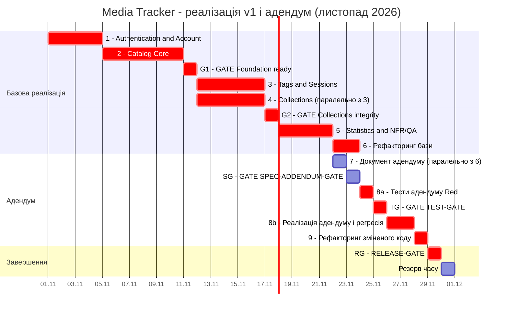

# План реалізації — Media Tracker v1 + адендум

Реалізація REST API за порядком лабораторної роботи №5.
Календарне вікно проєкту: 1-30 листопада 2026.
Етапи 1-9 виконує агент. Gate (контрольні точки) виконує людина:
Foundation, Collections integrity, SPEC-ADDENDUM-GATE, TEST-GATE,
RELEASE-GATE. Рішення кожного Gate записується в logs/.

> У REST API реалізуються лише вимоги з боку сервера (api-design.md,
> розділ 1). Клієнтські вимоги (F-005, F-006, F-011, F-021, F-022a, F-023,
> F-024, F-026, F-027) і UI-вимоги (NF-004, NF-005, NF-008) в API-тестах не
> перевіряються: API лише віддає й зберігає дані для них.

## Поетапний план

### Базова реалізація (кроки 2-3 лаби)

| № | Етап | Залежить від | Вимоги (серверна частина) | Тривалість | Outcome |
|---|---|---|---|---|---|
| 1 | Authentication & Account | — | F-001, F-002, F-003, F-029, NF-002, NF-006, NF-007, NF-009 | 4 дні | Модуль акаунта + лог тестів у logs/ |
| 2 | Catalog Core | 1 | F-004, F-007, F-008, F-009, F-025, F-028 (+ F-005, F-006, F-023, F-024, F-026 як дані в GET /items) | 6 днів | Каталог (CRUD, обкладинки) + лог |
| G1 | Gate: Foundation ready | 2 | перевіряє етапи 1 і 2 | 1 день | GO/REVISE у logs/gate-foundation.md |
| 3 | Tags & Sessions | G1 | F-010…014 | 5 днів | Теги, Sessions + лог |
| 4 | Collections | G1 | F-015…020 | 5 днів | Добірки (many-to-many, каскад) + лог |
| G2 | Gate: Collections integrity | 3, 4 | перевіряє етапи 3 і 4 та їх злиття | 1 день | GO/REVISE у logs/gate-collections.md |
| 5 | Statistics & NFR/QA | G2 | F-022, NF-001, NF-003 (+ F-021 лише збереження completedAt) | 4 дні | Завершена база, README, лог повного прогону |
| 6 | Рефакторинг бази | 5 | без зміни поведінки і контракту | 2 дні | Коміт + логи тестів «до» і «після» |

### Адендум ADD-07 (кроки 4-6 лаби)

| № | Етап | Залежить від | Вимоги | Тривалість | Outcome |
|---|---|---|---|---|---|
| 7 | Документ адендуму: зміна, AC, вплив на артефакти | 5 | нові/змінені REQ за ADD-07 | 1 день | spec/addendum-07.md, AC (з AC-040) |
| SG | Gate: SPEC-ADDENDUM-GATE | 7 | перевіряє етап 7 | 1 день | GO/REVISE у logs/gate-spec-addendum.md |
| 8а | Тести адендуму (Red) | 6, SG | AC адендуму | 1 день | Тести, що падають з очікуваної причини |
| TG | Gate: TEST-GATE | 8а | тести відповідають AC | 1 день | GO/REVISE у logs/gate-test-addendum.md |
| 8б | Реалізація адендуму (Green) + повна регресія | TG | за адендумом | 2 дні | Зелені тести, лог повного прогону |
| 9 | Рефакторинг зміненого коду | 8б | без зміни поведінки | 1 день | Коміт + повторний прогін тестів і контракту |

### Завершення (кроки 7-8 лаби)

| № | Етап | Залежить від | Що перевіряє | Тривалість | Outcome |
|---|---|---|---|---|---|
| RG | RELEASE-GATE | 9 | Верифікація (тести, SRS, OpenAPI, адендум) + валідація людиною (основні сценарії), оновлена матриця простежуваності | 1 день | GO/REVISE/STOP з обґрунтуванням у logs/gate-release.md |

## Паралельна робота

1. **Етапи 3 і 4 (12-16 листопада).** Теги з Sessions і Collections
   залежать лише від каталогу, а не одне від одного. Кожен іде у
   власній git-гілці, злиття відбувається перед G2.
2. **Етапи 6 і 7 (22-23 листопада).** Поки агент рефакторить код,
   пишеться документ адендуму в spec/. Вони не торкаються одне одного.

## Діаграма Ганта

Календарні дати:

| Етап | Дати |
|---|---|
| 1 | 1-4 листопада |
| 2 | 5-10 листопада |
| G1 | 11 листопада |
| 3 і 4 (паралельно) | 12-16 листопада |
| G2 | 17 листопада |
| 5 | 18-21 листопада |
| 6 і 7 (паралельно) | 22-23 листопада (7 займає 22-е) |
| SG | 23 листопада |
| 8а | 24 листопада |
| TG | 25 листопада |
| 8б | 26-27 листопада |
| 9 | 28 листопада |
| RG | 29 листопада |
| Резерв | 30 листопада |

Gate на діаграмі займає 1 день. Це вікно на перевірку й можливі
виправлення після неї, а не години самої роботи.

## Критичний шлях

1 → 2 → G1 → (3 ∥ 4) → G2 → 5 → 6 → 8а → TG → 8б → 9 → RG.
Гілка 7 → SG закінчується 23-го разом з етапом 6, запасу немає. Єдиний
запас часу це резерв 30 листопада, він покриває приблизно один цикл
REVISE.

### Вимоги з посиленим контролем

| Вимоги | Чому | Контроль |
|---|---|---|
| NF-002, NF-007 | Паролі та сесії: помилка компрометує акаунти | G1 (AC-035, AC-039) |
| F-009, F-015, F-019 | Каскадне видалення і many-to-many | Окремий тест в етапі 4 + G2 (AC-009, AC-015, AC-019) |
| NF-003 | Втрата даних користувача | RG (AC-036) |

## Оцінка людського часу (окремо від агента)

| Gate | Що перевіряє людина | Чисті зусилля |
|---|---|---|
| G1 | 19 AC (етапи 1-2) + 6 BDD, тести і лог | ~2-2,5 год |
| G2 | 12 AC (етапи 3-4) + AC-009 + 4 BDD, результат злиття | ~2 год |
| SG | повнота й несуперечливість адендуму, AC, вплив на артефакти | ~1 год |
| TG | тести відповідають AC, падають з очікуваної причини | ~1 год |
| RG | верифікація, сценарії вручну, матриця, рішення | ~2 год |

Крім Gate, людина переглядає git diff після етапів 1, 2, 3, 4, 5, 6,
8б, 9 (по ~20-30 хв, разом ≈3-4 год).

**Разом:** близько 11-13 годин людської роботи без дефектів і 15-18
годин, якщо трапиться один-два цикли REVISE. Темп проєкту задає
перевірка людиною, а не швидкість генерації коду.