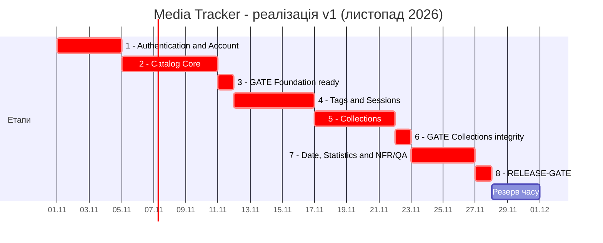

# План реалізації — Media Tracker v1

Реалізація розбита на 8 тікетів у GitHub Issues: 5 робочих і 3 Gate.
Номери нижче збігаються з номерами тікетів у репозиторії.
Календарне вікно проєкту: 1-30 листопада 2026.

## Поетапний план

| № | Тікет | Залежить від | Вимоги | Тривалість | Outcome |
|---|---|---|---|---|---|
| #1 | Authentication & Account | — | F-001, F-002, F-003, F-029, NF-002, NF-006, NF-007, NF-009 | 4 дні | Працюючий модуль акаунта + лог тестів у logs/ |
| #2 | Catalog Core | #1 | F-004…009, F-023…026, F-028 | 6 днів | Працюючий каталог (CRUD, фільтри, пошук, сортування, обкладинки) + лог |
| #3 | Gate: Foundation ready | #2 | перевіряє #1 і #2 | 1 день | Рішення GO/REVISE у logs/gate-foundation.md |
| #4 | Tags & Sessions | #3 | F-010…014 | 5 днів | Теги з автодоповненням і Sessions + лог |
| #5 | Collections | #4 | F-015…020, F-027 | 5 днів | Добірки (many-to-many, каскад) + лог |
| #6 | Gate: Collections integrity | #5 | перевіряє #4 і #5 | 1 день | Рішення GO/REVISE у logs/gate-collections.md |
| #7 | Date Auto-fill, Statistics & NFR/QA | #6 | F-021, F-022, F-022a, NF-001, NF-003, NF-004, NF-005, NF-008 | 4 дні | Завершений MVP, README, лог повного прогону |
| #8 | RELEASE-GATE | #7 | перевіряє #7 + наскрізний сценарій | 1 день | Рішення GO/REVISE у logs/gate-release.md |

Послідовність лінійна: кожен тікет працює поверх даних і сутностей
попереднього. Акаунт потрібен для прив'язки каталогу, теги, Sessions і
добірки працюють з елементами каталогу, статистика рахує завершені
елементи з урахуванням Sessions, тому вона останній функціональний блок.

### Де стоять Gate і чому

- **Gate: Foundation ready (#3)** стоїть після акаунта і каталогу. Усе
  подальше будується на цій основі, тому помилка тут найдорожча.
- **Gate: Collections integrity (#6)** стоїть після найризикованішої
  логіки (many-to-many, каскадне видалення, ризик R-08).
- **RELEASE-GATE (#8)** фінальне рішення перед релізом v1.

Кожен Gate перевіряє AC усіх тікетів перед ним, тому ручна перевірка
виконується один раз і не дублюється в робочих тікетах.

### Вимоги з посиленим контролем (висока ціна відмови)

| Вимоги | Чому | Контроль |
|---|---|---|
| NF-002, NF-007 | Збережені паролі та сесії: помилка компрометує акаунти | Gate: Foundation ready (AC-035, AC-039) |
| F-009, F-015, F-019 | Каскадне видалення і many-to-many: помилка залишає «осиротілі» або втрачені дані | Окремий тест у #5 + Gate: Collections integrity (AC-009, AC-015, AC-019) |
| NF-003 | Втрата даних користувача | RELEASE-GATE (AC-036) |

## Діаграма Ганта

Календарні дати:

| Тікет | Дати |
|---|---|
| #1 | 1-4 листопада |
| #2 | 5-10 листопада |
| #3 | 11 листопада |
| #4 | 12-16 листопада |
| #5 | 17-21 листопада |
| #6 | 22 листопада |
| #7 | 23-26 листопада |
| #8 | 27 листопада |
| Резерв | 28-30 листопада |

Gate на діаграмі займає 1 день. Це вікно на перевірку й можливі
виправлення після неї, а не години самої роботи.

## Критичний шлях

Залежності повністю лінійні (кожен тікет блокує наступний, паралельної
роботи немає), тому **критичний шлях дорівнює всій послідовності**:
#1 → #2 → #3 → #4 → #5 → #6 → #7 → #8. На діаграмі всі задачі позначені
як критичні. Затримка будь-якого тікета або Gate зсуває дату завершення
проєкту. Єдиний запас часу це резерв 28-30 листопада.

## Оцінка людського часу (окремо від агента)

Технічну частину (тести й реалізацію) агент виконує швидко, але
пропускну здатність проєкту обмежує людська частина. Її тривалість
оцінено двома способами: чисті зусилля (години) і календарна
тривалість (дні), яка враховує пошук часу, запис рішення та
виправлення після REVISE.

| Gate | Що перевіряє людина | Чисті зусилля | З одним циклом REVISE | У плані |
|---|---|---|---|---|
| #3 Foundation ready | 19 AC (#1: 8, #2: 11) + 6 BDD, читання тестів і лога | ~2-2,5 год | ~3-4,5 год | 1 день (до 2) |
| #6 Collections integrity | 12 AC (#4: 5, #5: 7) + AC-009 + 4 BDD, читання тестів і лога | ~1,5-2 год | ~2,5-4 год | 1 день (до 2) |
| #8 RELEASE-GATE | 8 AC + 1 BDD + наскрізний сценарій | ~1,5 год | ~2,5-3,5 год | 1 день |

Крім Gate, людина переглядає зміни агента (git diff) і тести перед
прийняттям кожного з 5 робочих тікетів, приблизно 20-30 хв на тікет
(≈2 год разом).

**Разом:** близько 7-8 годин людської роботи без дефектів і 10-12
годин, якщо трапиться один-два цикли REVISE. Це розтягується на
календарні дні, бо людина працює не безперервно. Саме перевірка і
рішення Gate, а не швидкість генерації коду, визначають темп проєкту.
Резерв 28-30 листопада покриває приблизно один цикл REVISE, який
виходить за 1 день на Gate.